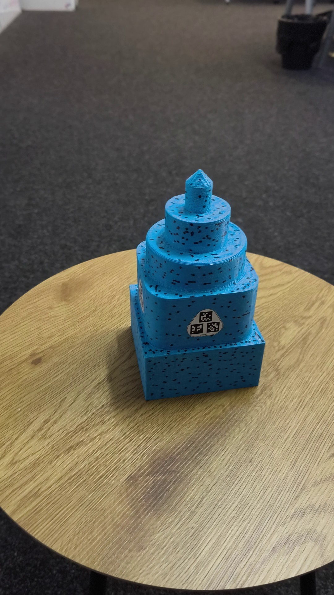

T001: stepped tower with AprilTag markers
=========================================

A 3D-printed object with known geometry and metric AprilTag markers, filmed with a phone.
Use it to test registration and scaling with markers, and to evaluate reconstructions against
ground truth (the CAD model).

Contents
--------
| File | Description |
|---|---|
| `images/` | 59 frames from a 27 s handheld video orbit: JPEG, 2160x3840 (portrait), no EXIF |
| `T001_cad.3mf`, `T001_cad.stl` | The CAD model, in mm. The base is centred on the origin, and z goes up from 0 |
| `markers.json` | Tag family and size, the tag layout of each sticker, and 266 tag detections (4 corners each) |
| `preview.jpg` | The object on the table, also a frame of the same video |

Object
------
- Steps of the CAD model:

  | Step | z (mm) |
  |---|---|
  | 100 mm square | 0-50 |
  | 90 mm square | 50-100 |
  | 80 mm cylinder | 100-125 |
  | 50 mm cylinder | 125-150 |
  | 20 mm cylinder | 150-170 |
  | Cone | 170-180 |

- FDM print with a random dot pattern for texture.
- Caliper measurements of the print: 99.2 / 89.3 / 79.3 / 49.6 / 19.75 mm. So the print is about
  0.8% smaller than the CAD in x and y; scale the CAD by 0.992 in x and y before comparing.
- The height is beyond the caliper's range. Assume it matches the CAD.

Markers
-------
- AprilTag `tag36h11`. Each tag measures 10.0 mm, the outer edge of the black border (caliper).
- Four stickers, one on each side wall of the 90 mm square step.
- Each sticker carries three tags whose centres form an equilateral triangle with 13 mm sides:

  | Sticker | Tag IDs (first tag at the apex) |
  |---|---|
  | INNER | 476, 283, 296 |
  | OUTER | 208, 510, 246 |
  | FRONT | 172, 6, 530 |
  | BOTTOM | 90, 91, 92 |

  The sticker names are labels only; they do not describe positions on the object.
- Known metric quantities: the tag edge (10 mm) and the tag-centre spacing within a sticker
  (13 mm). The stickers were placed by hand, so their positions on the object were not measured.
- Detections in `markers.json`:
  - one entry per image name, `{tag id: [4 corners]}`;
  - pixel origin at the top-left corner of the image, so the centre of the top-left pixel is (0.5, 0.5);
  - corners in OpenCV ArUco order (the tag's own top-left, top-right, bottom-right, bottom-left);
  - detected with OpenCV's ArUco module (`DICT_APRILTAG_36h11`) with sub-pixel corner refinement.

Camera
------
- Phone main camera, 4K video at 30 fps. The 59 frames were selected for sharpness and coverage.
- The camera is the same for all frames. Refined intrinsics (openmvg-rs and COLMAP agree):
  - focal length about 3235 px;
  - principal point near the image centre;
  - mild radial distortion (RADIAL model: k1 about 0.015, k2 about 0.03).

Reference results
-----------------
- Sparse reconstruction:
  `openmvg-sfm images --share-intrinsics --camera-model pinhole-radial2` registers 59/59 frames.
- Full pipeline: openmvg-rs or COLMAP poses, scale from the tags, then a dense mesh with OpenMVS.
  The scan matches the CAD with a median distance of 0.28-0.34 mm at the scale given by the tags.
  After a similarity fit to the CAD, the median is 0.21 mm.
- [openMVG/openmvg-rs#1](https://github.com/openMVG/openmvg-rs/issues/1) has the comparison and the
  textured scans.

License
-------
Copyright 2026 Berglung. Released under the license of this repository (CC BY-NC 4.0).
